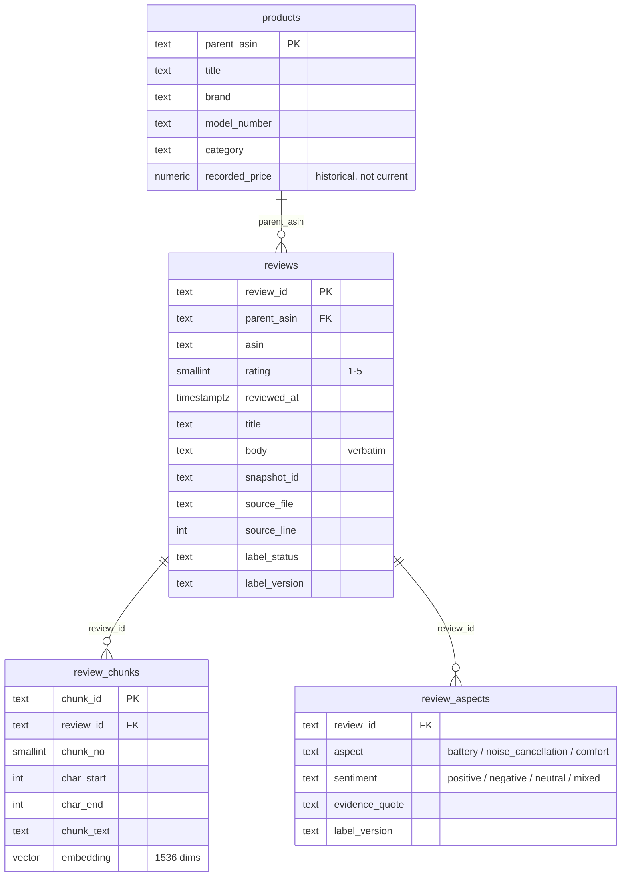

# Database

PostgreSQL 17 with the `vector` (pgvector) and `pg_trgm` extensions. The schema is created by the
numbered SQL files in `db/migrations`, applied in order by `uv run python -m db.migrate`. Applied
migrations are recorded in `schema_migrations` with a checksum; an applied file must never be edited
(add a new migration instead).

| Table | Grain | Used for |
|---|---|---|
| `products` | one row per parent product | identifying products |
| `reviews` | one row per approved English review | showing the original text; counting reviews |
| `review_chunks` | one row per chunk of a review | semantic search; every chunk points back to its review and character range |
| `review_aspects` | one row per review, aspect and label version | counting reviews that mention or complain about an aspect |

## Constraints that protect the data
- `reviews_approved_english_only`: only approved English reviews can be stored.
- `UNIQUE (source_file, source_line)` on `reviews` and `UNIQUE (review_id, chunk_no)` on
  `review_chunks`: re-running an import cannot create duplicates.
- `PRIMARY KEY (review_id, aspect, label_version)` on `review_aspects`: one label per review and
  aspect within a label version; older versions are kept for comparison.
- Rating, aspect, sentiment and label status are limited to their allowed values with `CHECK`.

## Tests
Database tests use the `fresh_database_url` fixture (`tests/conftest.py`), which creates an empty
database with a random name for each test and drops it afterwards, so tests never touch development data.

## DB-01 acceptance: one review counts as one complaint
`tests/test_db01.py` loads R17, a real approved review (fixture `tests/fixtures/r17.json`, user id removed),
into an empty test database. Two of its three chunks criticize the same aspect (pressure and pain
around the ears); one manual negative `comfort` label (`label_version = manual-db01`) is added.

| Step | Check | Result |
|---|---|---|
| 1 Load | rows in `reviews` / `review_chunks` / `review_aspects`; every chunk equals `body[char_start:char_end]` | 1 / 3 / 1; 0 mismatches |
| 2 Retrieve | two known negative excerpts | 2 different chunks, both pointing to the same review |
| 3 Count | complaining reviews / labeled reviews | 1 / 1 (joining chunks to labels would wrongly give 3) |
| 4 Re-run | load the same data again | 0 new rows; still 1 / 3 / 1 and 1 complaint |

Complaints are counted with `count(DISTINCT review_id)` on `review_aspects`, filtered by product,
labeled status and label version, never by joining chunks to labels.